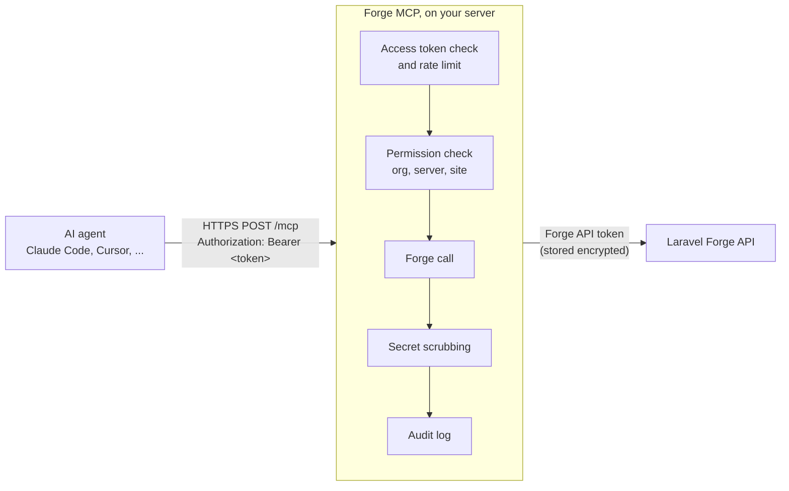

# Forge MCP documentation

Forge MCP is a self-hosted Laravel app that lets AI coding agents (Claude Code, Cursor and any other MCP client) operate your [Laravel Forge](https://forge.laravel.com) servers and sites over the Model Context Protocol. It runs on your own server, holds your Forge API token encrypted, and gives each agent its own access token with permissions you control. Every tool result is scrubbed of known secrets, and every permission-checked tool call (allowed, denied or failed) is written to an audit log.

## Who it is for

- Developers who host Laravel apps on Forge and want their coding agent to check a deployment, read logs, restart a worker or ship a fix without leaving the session.
- Teams that want that convenience without handing an agent a full-power Forge API token.
- Contributors who want to extend it (see [Contributing](contributing.md)).

## How it works



In plain text:

```text
agent ──HTTPS /mcp + bearer token──▶ Forge MCP ──Forge API token──▶ forge.laravel.com/api
                                     │
                                     ├─ is the access token valid? (rate limit: 120 requests/minute)
                                     ├─ may this token use this capability on this org / server / site?
                                     ├─ call Forge
                                     ├─ scrub secrets from the result
                                     └─ write an audit log entry (success, denied or error)
```

The agent never sees your Forge API token. It only sees the tools its access token is allowed to use.

## Contents

| Page | What it covers |
|---|---|
| [Getting started](getting-started.md) | The ten-minute path: deploy, set up, connect Forge, create a token, connect Claude Code, first prompts. |
| [Installation](installation.md) | Installing on Laravel Forge or any PHP 8.4 host, requirements, upgrading, uninstalling. |
| [Configuration](configuration.md) | Environment variables, Forge MCP tunables, rate limits, audit retention. |
| [Forge API token](forge-api-token.md) | Creating the Forge token, the scopes each capability needs, minimum-scope recipes. |
| [Connecting clients](connecting-clients.md) | Claude Code, Cursor, generic JSON config, one token per agent, rotating and revoking. |
| [Project defaults](project-defaults.md) | Default organization, server and site from project headers or per access token, precedence, the empty header trap. |
| [Claude Code plugin](claude-code-plugin.md) | Installing the `forge-mcp` plugin, `/forge-mcp:configure` and `/forge-mcp:diagnose`, environment variables, troubleshooting. |
| [Dashboard](dashboard.md) | Every page of the web dashboard. |
| [Permissions](permissions.md) | Capabilities, tiers, defaults, overrides, how rules are resolved, worked examples. |
| [Security](security.md) | Threat model, secret scrubbing, audit log, token storage, reporting vulnerabilities. |
| [Tool reference](tools.md) | Every MCP tool with its capability, arguments and behaviour, plus the `diagnose_failed_deploy` prompt. |
| [Migrating from bretterer/forge-mcp-server](migrating-from-bretterer.md) | Tool name changes and how to switch. |
| [Troubleshooting](troubleshooting.md) | Common errors and what to do about them. |
| [Contributing](contributing.md) | Architecture overview and how to add a tool. |

The [project README](../README.md) has a shorter overview, and [SECURITY.md](../SECURITY.md) explains how to report a vulnerability.
